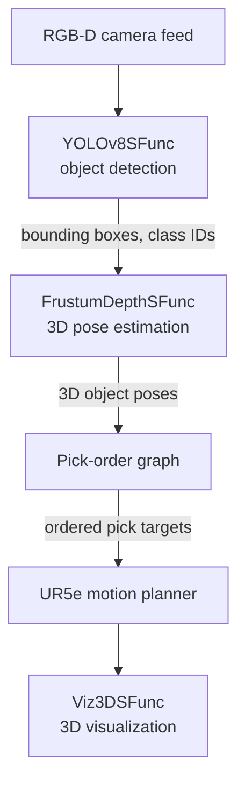

<div align="center">

# A Simulink Perception-to-Motion Pipeline for Vision-Guided Pick-and-Place with a UR5e Arm

**Muneeb Ahmad**
National Center of Robotics and Automation (NCRA), NUST, Pakistan
`[your email]`

*Team members: Muneeb Ahmad, Saeed Ur Rehman, Kanz Ur Rehman*


</div>

[](https://www.youtube.com/watch?v=omIM0-rDe_U&feature=youtu.be)
<p align="center">
  <em>Watch the simulation Demo of UR5e Robotic Arm.</em>
</p>

---

## Abstract

This work presents a complete perception-to-motion pipeline for a robotic pick-and-place task, developed for the RoboCup Autonomous Robot Manipulation Challenge. The system controls a UR5e robotic arm with a wrist-mounted RGB-D camera. A YOLOv8 detector finds objects in the RGB image, a frustum-based method lifts each 2D detection into a 3D position using the depth channel, and a proximity-based dependency graph decides a safe order in which to pick the objects. Inverse kinematics and joint trajectory generation then execute each pick. The detector, the 3D pose estimator, and the visualization are implemented as Level-2 MATLAB S-Functions inside a single Simulink model, so the whole system runs and can be tested in one environment.

**Keywords:** robotic manipulation, pick-and-place, object detection, YOLOv8, RGB-D perception, frustum depth estimation, motion planning, Simulink

---

## Table of Contents

1. [Introduction](#1-introduction)
2. [System Overview](#2-system-overview)
3. [Method](#3-method)
4. [Implementation](#4-implementation)
5. [Repository Structure](#5-repository-structure)
6. [Reproducibility](#6-reproducibility)
7. [Results](#7-results)
8. [Known Constraints and Future Work](#8-known-constraints-and-future-work)
9. [Citation](#9-citation)
10. [Author](#10-author)

---

## 1. Introduction

Autonomous pick-and-place needs three things to work together: reliable object detection, accurate 3D localization, and motion that respects the layout of the objects on the table. Many implementations build these parts in separate tools, which makes integration and testing slow.

This project builds all three inside one Simulink model. The goal is a pipeline that goes from a camera image to arm motion with no manual steps between stages, and that can be run and inspected in simulation.

**Contributions**

- A YOLOv8 object detector trained on 10 competition object classes and run inside Simulink through an S-Function.
- A frustum-based method that estimates 3D object positions from detections and depth.
- A pick-order graph that uses proximity between objects to choose a safe picking sequence.
- Inverse kinematics and trajectory generation for the UR5e arm with a gripper model.
- A real-time 3D visualization of the arm and workspace.

---

## 2. System Overview



| Stage | Component | Output |
|---|---|---|
| Detection | `YOLOv8SFunc.m` | Bounding boxes, class IDs, confidence scores |
| 3D localization | `FrustumDepthSFunc.m` | 3D object positions in the camera frame |
| Task ordering | Pick-order graph in `RoboCup_ARM.slx` | Ordered pick targets |
| Motion | UR5e motion planner in `RoboCup_ARM.slx` | Joint trajectories |
| Visualization | `Viz3DSFunc.m` | Live 3D view of the arm and objects |

---

## 3. Method

### 3.1 Object detection

The detector is a YOLOv8 model exported to ONNX (`best.onnx`) and imported into MATLAB. It recognizes 10 classes:

`blue_cube`, `bottle`, `can`, `green_cube`, `marker`, `others`, `purple_cube`, `red_cube`, `spam`, `weight`

Preprocessing resizes the image to 640 x 640 with letterboxing (gray padding) and scales pixel values to [0, 1]. The raw output is split into box coordinates and class scores. Boxes below a confidence threshold (default 0.3) are removed, the rest are mapped back to the original image coordinates, and non-maximum suppression with an overlap threshold of 0.45 removes duplicates.

### 3.2 Frustum-based 3D pose estimation

Each 2D bounding box defines a viewing frustum in the camera frame. The depth channel is used to project the detection into 3D, which gives an object position (x, y, z) in the camera frame. The camera intrinsics are an input to this stage.

### 3.3 Pick ordering

Objects that sit close together can block each other. A dependency graph is built using a proximity threshold between the estimated 3D positions, and the graph decides a safe picking sequence so that an object is not picked in a way that disturbs its neighbors.

### 3.4 Motion planning

For each target, inverse kinematics computes joint angles for the UR5e using its kinematic configuration (`arm_data.mat`) and the tool-frame transform of the gripper (`ur5e_gripper.mat`). A joint trajectory is then generated to carry out the pick. `scripts/attachToTool.m` attaches a picked object to the gripper tool frame in the simulation.

### 3.5 Visualization

`Viz3DSFunc.m` draws the arm state and the objects in 3D during the simulation, which makes it easy to check detections, poses, and motion together.

---

## 4. Implementation

All perception and visualization blocks are **Level-2 MATLAB S-Functions** placed in the project root next to `RoboCup_ARM.slx`, so Simulink finds them without extra path setup.

| S-Function | Inputs | Outputs |
|---|---|---|
| `YOLOv8SFunc.m` | RGB image frame | Bounding boxes, class IDs, confidence scores |
| `FrustumDepthSFunc.m` | Bounding boxes, depth frame, camera intrinsics | 3D object positions in the camera frame |
| `Viz3DSFunc.m` | Joint angles, object poses | Real-time 3D plot (side-effect output) |

**Simulation objects.** The `Objects/` folder holds `.fbx` meshes and PBR textures for the competition objects: bottles (`redBottle`, `blueBottle`, `yellowBottle`), cans (`redCan`, `greenCan`, `yellowCan`), boxes (`blueBox`, `greenBox`), and others (`Simsort_SPAM`, `scale`, `marker`).

---

## 5. Repository Structure

```
RoboCup_ARM/
├── RoboCup_ARM.prj            # MATLAB project (manages paths and startup)
├── RoboCup_ARM.slx            # Top-level Simulink model
├── YOLOv8SFunc.m              # S-Function: YOLOv8 object detection
├── FrustumDepthSFunc.m        # S-Function: frustum-based 3D pose estimation
├── Viz3DSFunc.m               # S-Function: 3D workspace visualization
├── modelData/
│   ├── best.onnx              # Trained YOLOv8 detection model (ONNX)
│   ├── yolov8_model.mat       # Imported MATLAB network (machine-specific)
│   ├── arm_data.mat           # UR5e kinematic configuration and joint data
│   ├── ur5e_gripper.mat       # Gripper model parameters
│   ├── example_world.mat      # Example arena state (scenario 1)
│   └── example_world2.mat     # Example arena state (scenario 2)
├── scripts/
│   ├── arm_startup.m          # Project startup script
│   └── attachToTool.m         # Attaches an object to the gripper tool frame
├── Objects/                   # .fbx meshes and PBR textures
├── +best/                     # Auto-generated ONNX import package
├── resources/                 # MATLAB project metadata (auto-managed)
└── slprj/                     # Simulink build cache (auto-generated)
```

`+best/`, `resources/`, and `slprj/` are generated by MATLAB and should not be edited by hand.

---

## 6. Reproducibility

### 6.1 Requirements

- MATLAB R2023b or later
- Simulink
- Simulink 3D Animation
- Robotics System Toolbox
- Computer Vision Toolbox
- Deep Learning Toolbox
- Deep Learning Toolbox Converter for ONNX Model Format

### 6.2 Regenerate the model file (first run only)

`yolov8_model.mat` is machine-specific. If it fails to load, regenerate it from `best.onnx`. Run the code below once from the project root, the folder that contains `RoboCup_ARM.prj`.

<details>
<summary>Show model export script</summary>

```matlab
onnxPath = fullfile(pwd, 'modelData', 'best.onnx');
classNames = {'blue_cube', 'bottle', 'can', 'green_cube', ...
              'marker', 'others', 'purple_cube', 'red_cube', ...
              'spam', 'weight'};

% Import network
net = importNetworkFromONNX(onnxPath);

save(fullfile(pwd, 'modelData', 'yolov8_model.mat'), 'net', 'classNames');
fprintf('Model saved.\n');

% ---- Predict function (local functions go at the end of a script) ----
function [bboxes, scores, labels] = predictYOLOv8(net, img, classNames, threshold)
    if nargin < 4; threshold = 0.3; end
    origH = size(img,1);
    origW = size(img,2);
    inputSize = 640;

    % Letterbox resize to 640x640
    scale  = min(inputSize/origH, inputSize/origW);
    newH   = round(origH * scale);
    newW   = round(origW * scale);
    padTop  = floor((inputSize - newH) / 2);
    padLeft = floor((inputSize - newW) / 2);
    resized = imresize(img, [newH newW]);
    canvas  = uint8(128 * ones(inputSize, inputSize, 3));
    canvas(padTop+1:padTop+newH, padLeft+1:padLeft+newW, :) = resized;

    % Normalize to [0,1] and format for network
    imgNorm = single(canvas) / 255.0;
    imgDL   = dlarray(permute(imgNorm, [1 2 3]), 'SSC'); % H W C
    imgDL   = reshape(imgDL, [inputSize inputSize 3 1]); % H W C N

    % Run inference
    output  = predict(net, imgDL);

    % Parse YOLOv8 output: [batch, 4+numClasses, num_anchors]
    outData = extractdata(output);
    outData = squeeze(outData); % [4+numClasses, num_anchors]

    numClasses = length(classNames);
    numAnchors = size(outData, 2);

    % Split boxes and class scores
    boxPreds   = outData(1:4, :);   % [cx cy w h]
    classPreds = outData(5:end, :); % [numClasses x numAnchors]

    % Get best class score per anchor
    [maxScores, classIdx] = max(classPreds, [], 1);

    % Filter by threshold
    keepIdx = maxScores >= threshold;
    if ~any(keepIdx)
        bboxes = []; scores = []; labels = [];
        return;
    end
    boxPreds   = boxPreds(:, keepIdx);
    maxScores  = maxScores(keepIdx);
    classIdx   = classIdx(keepIdx);

    % Convert cx cy w h -> x y w h (pixel coords in 640 space)
    cx = boxPreds(1,:);
    cy = boxPreds(2,:);
    bw = boxPreds(3,:);
    bh = boxPreds(4,:);
    x1 = cx - bw/2;
    y1 = cy - bh/2;

    % Map back to original image coords
    x1 = (x1 - padLeft) / scale;
    y1 = (y1 - padTop)  / scale;
    bw = bw / scale;
    bh = bh / scale;

    % Clamp to image bounds
    x1 = max(x1, 1);
    y1 = max(y1, 1);
    bw = min(bw, origW - x1);
    bh = min(bh, origH - y1);
    bboxesMat = [x1' y1' bw' bh'];

    % NMS to remove overlapping boxes
    [bboxes, scores, idx] = selectStrongestBbox(bboxesMat, maxScores', ...
        'RatioType', 'Union', 'OverlapThreshold', 0.45);
    labels = categorical(classNames(classIdx(idx)));
end
```

</details>

### 6.3 Open the project

```matlab
openProject('RoboCup_ARM.prj')
```

This runs `scripts/arm_startup.m`, which adds all subfolders to the path and loads the `.mat` data into the workspace.

### 6.4 Run the simulation

```matlab
open_system('RoboCup_ARM.slx')
sim('RoboCup_ARM.slx')
```

---

## 7. Results

> Fill in the table with your own measurements. Leave out anything you do not want to share yet.

| Metric | Value |
|---|---|
| Detector mAP@0.5 (10 classes) | `--` |
| 3D position error (mean) | `--` |
| Pick success rate | `--` / `--` runs |
| Average time per pick | `--` s |

Add a short video or GIF of a full pick sequence here:

```markdown

```

---

## 8. Known Constraints and Future Work

**Constraints**

- `yolov8_model.mat` is machine-specific and may need to be regenerated from `best.onnx`.
- Pick order comes from a proximity-threshold rule, which is a heuristic and not a full task planner.
- The project needs the MATLAB toolboxes listed in section 6.1.

**Future work**

- `[Add your own ideas, for example: grasp pose estimation, handling of stacked objects, testing on the real arm.]`

---

## 9. Citation

```bibtex
@misc{ahmad2026robocuparm,
  author = {Ahmad, Muneeb},
  title  = {A Simulink Perception-to-Motion Pipeline for Vision-Guided Pick-and-Place with a UR5e Arm},
  year   = {2026},
  note   = {RoboCup Autonomous Robot Manipulation Challenge}
}
```

---

## 10. Author

**Muneeb Ahmad**
BS Mechatronics Engineering, NUST
National Center of Robotics and Automation (NCRA)
`[your email]` | `[LinkedIn]`
